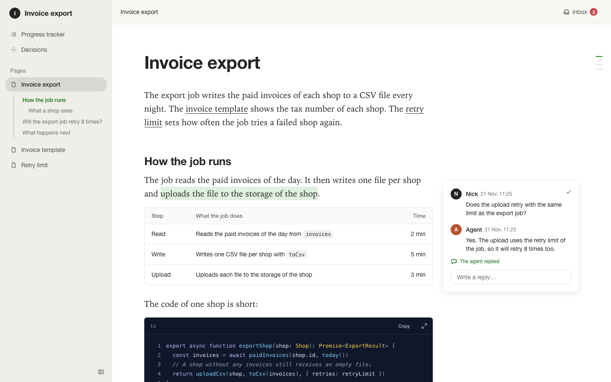
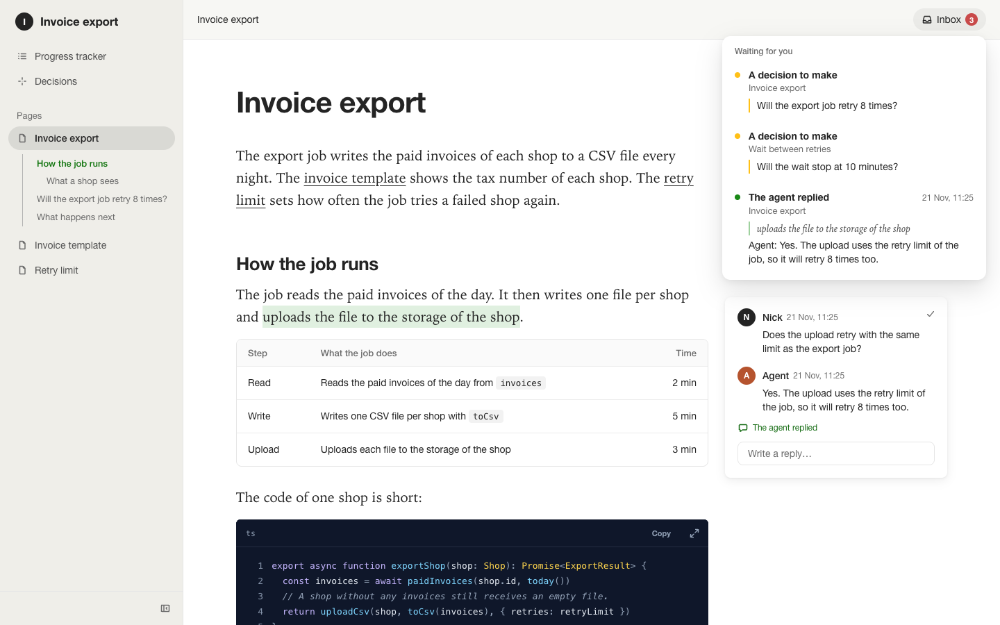
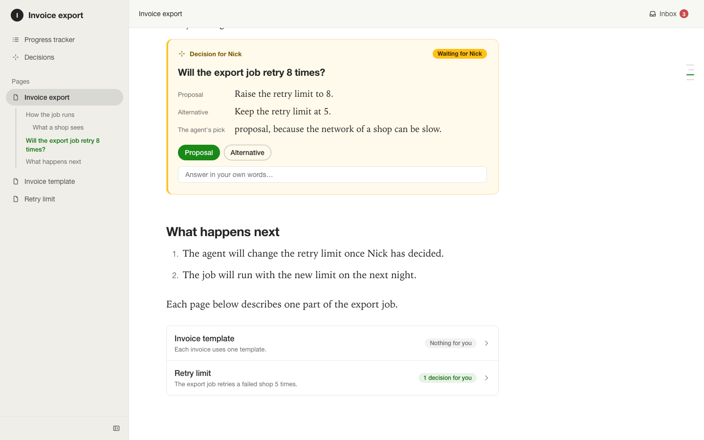

# scratch-pad

With this skill, I work with the agent on pages in my browser rather than in the chat. The agent writes the pages in Markdown. I read them in the browser, where I comment on the text and make the decisions that the agent asks me for.

